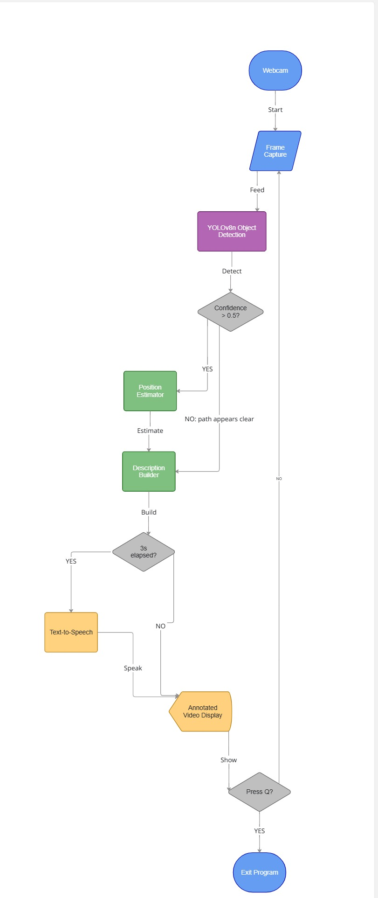

# Object Detection: Accessibility Navigator

This is the first AI module of Frobot, my accessibility companion robot.

It looks through a camera, figures out what's in front of you, and tells you out loud where things are: "chair on your left", "person ahead of you". The idea is to give visually impaired people a quick sense of their surroundings.

## Why I built this
Most vision apps for blind users need a phone held up and a good internet connection. I wanted something that runs fully offline on a laptop, and later on the robot itself, and that tells you not only *what* is nearby but *which side* it's on.

## What it does
- Detects 80 kinds of everyday objects in real time using YOLOv8n
- Says things like "chair on your left" or "person ahead of you"
- Works offline once the model is downloaded
- Ignores low-confidence guesses (below 50%) and removes duplicate objects
- Announces at most 3 objects at a time
- Says "Path appears clear" when nothing is detected
- Shows a live video window with boxes around what it found

## How the program runs


## Technology Stack and Rationale
- **YOLOv8n** - smallest YOLOv8 model (about 6 MB), runs in real time on a laptop CPU
- **OpenCV** - captures webcam frames and shows the live video with boxes
- **pyttsx3** - offline text-to-speech, so it works without internet
- **Python threading** - speech runs in its own thread, so the camera feed never freezes

## Design Decisions
- **Left / ahead / right zones** - simple and fast, and the user can act on it without a depth sensor
- **3-second speech interval** - constant talking would overwhelm the user
- **Confidence threshold of 0.5** - ignores uncertain detections so the user isn't given wrong information
- **Maximum of 3 objects per announcement** - keeps each message short and easy to follow

## Running it (Windows)
Tested with Python 3.12.
```bash
git clone https://github.com/ashmita705/frobot.git
cd frobot/object-detection
python -m venv venv
venv\Scripts\activate
pip install -r requirements.txt
python main.py
```
The YOLOv8n model downloads itself the first time you run it.

Allow camera access, and it starts describing what it sees every 3 seconds. Press **Q** in the video window to quit.

## How well it works
Tested on: ___ (laptop, CPU, RAM)

| Metric | Result |
|---|---|
| Average FPS | ___ |
| Time per frame | ___ ms |

| Situation | What happened |
|---|---|
| Person in front of the camera | ___ |
| Chair or table | ___ |
| Small things like a bottle or phone | ___ |
| Low light | ___ |

## Problems I ran into
- **Problem:** YOLO detected objects but pyttsx3 did not speak. The program printed the text but no sound came out.
  **Fix:** I tested pyttsx3 separately and it worked, so I reworked the pipeline between detection and speech until they worked together. Speech now runs in its own thread every 3 seconds.
- **Problem:** The camera turned on but YOLO did not detect objects, and detection and speech would not work together.
  **Fix:** I think the YOLO version I installed did not work well with the other libraries on my computer. I switched to a different YOLO version, and the project now runs on `ultralytics 8.4.115`.

## What it can't do yet
- It doesn't know distance, only left, ahead or right
- It only knows the standard COCO objects, so no stairs, curbs or doors
- It struggles in poor light or with a bad camera
- It only works on Windows because it uses the Windows speech driver
- Speech can overlap if an announcement runs longer than 3 seconds
- The order of objects in an announcement can change from one announcement to the next

## Where this could be useful
- A navigation aid for visually impaired people
- Smart glasses or a wearable camera
- Mobile robots like Frobot
- Elderly care and home assistance

## What I want to add next
- Estimate distance from the size of the bounding box
- Warn about hazards first (people, vehicles, stairs)
- Make speech work on Mac and Linux, and stop announcements from overlapping
- rain a custom model for stairs, doors and curbs
- Run it on a Raspberry Pi or Jetson
- Plug it into the Frobot robot

## Author
Titli · [GitHub](https://github.com/ashmita705)
